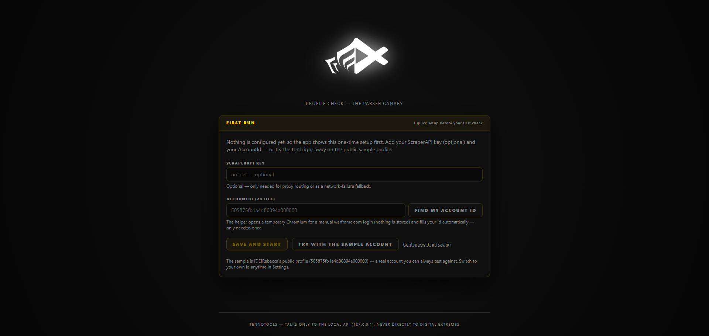
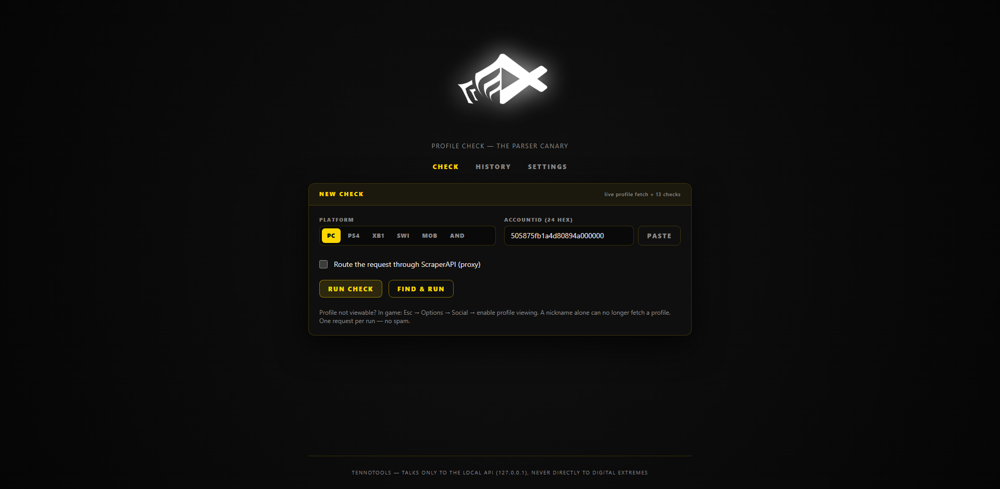
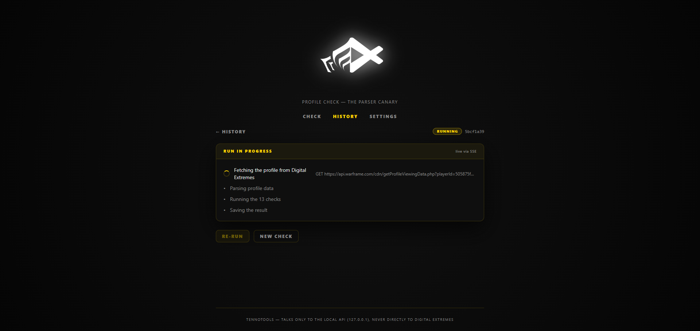
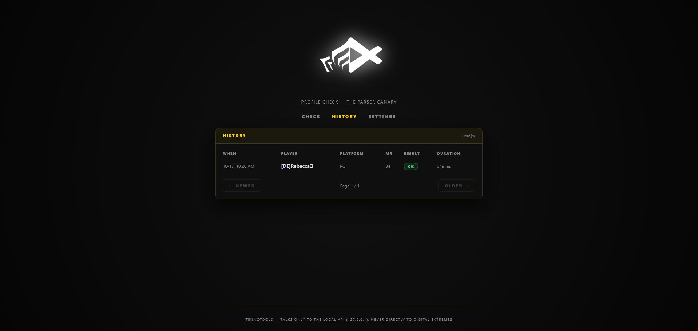
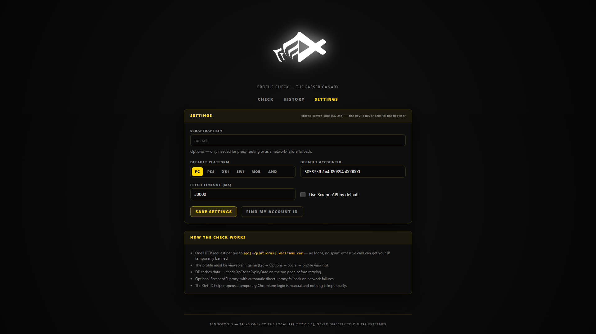
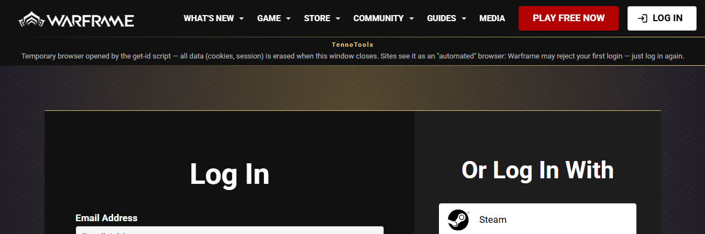

<p align="center">
  
</p>

<h1 align="center">TennoTools Profile Check</h1>

<p align="center">
  <b>The Warframe profile-parser canary</b><br />
  Local live-check for the Warframe public profile endpoint — fetch a profile, parse it,<br />
  run 13 frozen validation checks, get a verdict.
</p>

<p align="center">
  
  
  
  
  
</p>

<p align="center">
  Project site &amp; docs — <a href="https://tennotools.github.io/profile-check/">tennotools.github.io/profile-check</a>
</p>

Local tool that verifies **live Warframe profile data** served by Digital Extremes still parses
correctly: fetch a profile by AccountId, parse it, run 13 frozen validation checks, show a verdict —
in a local web GUI (TennoTools theme) with run history.

- **13 frozen checks** — v1 labels and critical flags, verdict `ok` / `warnings` / `broken`
- **Live progress** — SSE stream: fetch → parse → validate → persist
- **Run history** — every run stored locally in SQLite (`data/app.sqlite`)
- **Find my Account ID** — a temporary Chromium for a manual warframe.com login; your id is detected
  and saved, nothing else
- **Optional ScraperAPI fallback** — one retry on network failure; the key never leaves the machine
- **Local-only by design** — GUI and API both on `127.0.0.1`, no telemetry of any kind

## Screenshots

<p align="center">
  <br />
  <sub><i><b>First run</b> — the <code>/init</code> wizard: key (optional), AccountId or the public sample; no nav until configured.</i></sub>
</p>

<p align="center">
  <br />
  <sub><i><b>Check</b> — platform, pasted or saved AccountId, one request per run.</i></sub>
</p>

<p align="center">
  <br />
  <sub><i><b>Run in progress</b> — live SSE progress: fetch → parse → 13 checks → save; the exact request URL is shown.</i></sub>
</p>

<p align="center">
  <br />
  <sub><i><b>History</b> — every run with player, platform, MR, verdict and duration.</i></sub>
</p>

<p align="center">
  <br />
  <sub><i><b>Settings</b> — the ScraperAPI key stays server-side (SQLite) and is never sent to the browser.</i></sub>
</p>

<p align="center">
  <br />
  <sub><i><b>Find my Account ID</b> — the temporary browser with its TennoTools banner; login is manual, nothing is kept.</i></sub>
</p>

## Architecture (npm workspaces, TypeScript everywhere)

```
packages/core    shared logic: platform hosts, DE fetch (+ScraperAPI fallback), typed parser
                 wrapper, the 13 checks, zod schemas, formatting — CLI-ready for a future re-add
apps/server      Fastify on 127.0.0.1:8787 · better-sqlite3 history (data/app.sqlite) ·
                 SSE live progress · Playwright Get-ID job · serves the built web app
apps/web         React 19 + Vite + Tailwind 4 GUI (black/gold TennoTools theme)
scripts/         check-once.ts — one-shot terminal check (parity / fixture capture)
                 launch.mjs — quick-launch logic behind launch.bat / launch.sh
docs/            static GitHub Pages site: landing, guide, the 13 checks (same theme, no JS)
```

Everything is local-only: the server binds `127.0.0.1`, the ScraperAPI key never leaves the machine
(it lives in SQLite and is only echoed back masked), and there is no telemetry of any kind.

## Quick launch (no terminal skills)

Only a [Node.js ≥ 22.12](https://nodejs.org) install is needed, the launcher handles the rest:

- **Windows** — double-click **`launch.bat`**
- **Linux / macOS** — `./launch.sh` (first time only: `chmod +x launch.sh`)

It checks Node, runs `npm install` on the very first launch, downloads the Chromium helper for
**Find my Account ID** (~130 MB, one time), rebuilds the app whenever the sources changed, then starts it
in production mode on `http://127.0.0.1:8787` and opens your browser. Later launches take seconds —
nothing is re-installed or re-built unless needed. Keep its window open while you use the app: it shows
compact logs (`[web]` for pages and assets, `[api]` for the server, `[db]` for the database) and pressing
`Q` stops Profile Check cleanly - the SQLite WAL is checkpointed on the way out.

## Quick start (dev)

Requirements: Node ≥ 22.12 (tested on 24), npm ≥ 10.

```bash
npm install
npx playwright install chromium   # only needed for the "Find my Account ID" helper
npm run dev                        # API on :8787 + GUI on http://localhost:5173
```

Open http://localhost:5173 — Vite proxies `/api` to the local server (SSE works through it). If the
API is still booting (or crashed), the page answers with a clean 503 and the GUI shows an **offline
banner + Retry buttons** — no terminal stack spam, and everything recovers on its own the moment the
API answers again.

## Production mode (single process)

```bash
npm run build     # typechecks + builds the GUI
npm start         # API + GUI on http://127.0.0.1:8787
```

## First run

1. **`/init` wizard** — with nothing configured yet, every app page redirects to a standalone first-run
   screen (no nav): paste your ScraperAPI key (optional), find your AccountId with **Find my
   Account ID** (temporary Chromium, manual login, nothing stored) — or press **Try with the sample
   account** to test the pipeline on [DE]Rebecca's public profile. Saving a key or an id leaves the
   wizard for good (skipping unlocks the app for the session and re-proposes it next session).
2. **Check** — **Find & run** finds your AccountId and launches the check as soon as it is found; you
   can also **Paste** a known 24-hex id or reuse the **saved** one. The finder alone lives in
   **Settings**.
3. Watch the live progress (SSE) and read the verdict; each run is kept in **History**.

## What a check does

1. **Fetch** — exactly one HTTP request to
   `https://api[-<platform>].warframe.com/cdn/getProfileViewingData.php?playerId=<id>`
   (`pc` uses `api.warframe.com`; consoles use `api-ps4|x-xb1|api-swi|api-mob|api-and`).
   With a ScraperAPI key, a network-level failure triggers a single retry through the proxy
   (`direct → scraperapi-fallback`). HTTP error statuses are never retried.
2. **Parse** — `new ProfileParser(data, 'en', withItem=false)`.
3. **Validate** — the 13 frozen checks (6 critical), run through a safe wrapper (an exception becomes
   a failed check):

| # | Check (exact label) | Critical |
| --- | --- | --- |
| 1 | `profile.displayName is a non-empty string` | yes |
| 2 | `profile.accountId matches the requested id` | no |
| 3 | `profile.accountId is a 24-char hex ObjectId` | yes |
| 4 | `profile.masteryRank is an integer >= 0` | yes |
| 5 | `profile.created is a valid Date` | yes |
| 6 | `profile.loadout is built (suits/xpInfo arrays)` | yes |
| 7 | `profile.missions is an array` | no |
| 8 | `profile.challengeProgress is an array (Nightwave)` | no |
| 9 | `profile.intrinsics is an object` | no |
| 10 | `stats.timePlayedSec is a finite number` | yes |
| 11 | `stats.missionsCompleted is a number` | no |
| 12 | `stats.weapons and stats.enemies are arrays` | no |
| 13 | `xpCacheExpiryDate / ceremonyResetDate are parsed Dates` | no |

4. **Verdict** — any critical fail → `broken`; only non-critical fails → `warnings`; else `ok`.
5. **Persist** — summary + checks + request metadata in `data/app.sqlite`.

## Scripts

| Script | What it does |
| --- | --- |
| `npm run dev` | API (node --watch + tsx) + web (Vite) together — GUI shows an offline banner if the API is down |
| `npm run build` | typecheck all packages + build the web app into `apps/web/dist` |
| `npm start` | serve API + built GUI on `http://127.0.0.1:8787` |
| `npm test` | vitest — 58 tests (unit + API integration + web API client + offline live-fixture parity) |
| `npm run typecheck` | tsc on core, server and web |
| `npm run lint` / `npm run format` | Biome check / auto-fix |
| `npm run check:live` | one-shot terminal check against DE (1 request), refreshes the test fixture |
| `npm run check:offline` | same pipeline on the saved fixture, no network |
| `npm run db:checkpoint` | fold the SQLite WAL into `data/app.sqlite` so any viewer can read it (also run automatically on every launcher stop) |

## Configuration

`.env` at the repo root is a **bootstrap only** (read once at startup, missing keys are seeded into
the settings DB; the GUI is the source of truth afterwards):

| Key | Meaning |
| --- | --- |
| `SCRAPERAPI_KEY` | optional proxy key |
| `WARFRAME_ACCOUNT_ID` | your AccountId, used as the default in the GUI |

Environment overrides: `TENNOTOOLS_HOST` (default `127.0.0.1`), `TENNOTOOLS_PORT` (default `8787`),
`TENNOTOOLS_DB_PATH` (default `data/app.sqlite`).

Inspecting the database: run history lives in `data/app.sqlite` (SQLite, WAL mode). The WAL is
checkpointed automatically on every clean stop (the launcher prints a `[db]` line) and on the next
start after a crash, so the file is self-contained; `npm run db:checkpoint` remains available any
time. Never upload it anywhere: the settings table holds your ScraperAPI key in clear text.

## Local API (for integrations)

| Method | Path | Purpose |
| --- | --- | --- |
| GET | `/api/health` | liveness |
| POST | `/api/runs` | start a check `{platform, accountId, useProxy}` → 202 `{id}` |
| GET | `/api/runs?limit&offset` | history list |
| GET | `/api/runs/:id` | full run result |
| GET | `/api/runs/:id/events` | SSE: `progress` / `done` / `error` (replays history to late subscribers) |
| GET/PUT | `/api/settings` | settings view / update (key always returned masked) |
| POST | `/api/account-id/discover` | start the Playwright Get-ID job → 202 `{jobId}` |
| GET | `/api/account-id/discover/events?jobId=` | SSE status stream |
| POST | `/api/account-id/discover/cancel` | cancel the running job |

All payloads are validated with zod schemas shared from `@tennotools/profile-check-core`.

## Rules of engagement (hard-won)

- The **only working endpoint** is `api[-<platform>].warframe.com/cdn/getProfileViewingData.php?playerId=`;
  DE removed the old nickname endpoint — a nickname alone can no longer fetch a profile.
- The profile must be **viewable in game** (Esc → Options → Social → profile viewing), otherwise DE
  answers 500 even for a valid id.
- DE **caches** responses — the run page shows `XpCacheExpiryDate`; wait for expiry before retrying.
- **Do not spam the API**: excessive calls can temporarily ban your IP, which also blocks game login.
  One request per run is all this tool ever does (plus at most one ScraperAPI fallback).
- AccountIds are MongoDB ObjectIds: 24 hex chars whose first 4 bytes are a creation timestamp —
  that is what `looksLikeAccountId` checks (2012 → now+1 year).

## Tests

```bash
npm test
```

- `packages/core/test` — 13-check labels/critical flags frozen, account-id heuristics, fetch
  semantics (fallback, timeouts, error explanations), zod schemas, plus an **offline parity test on a
  real DE response** captured in `packages/core/test/fixtures/profile.raw.json` (refresh with
  `npm run check:live`).
- `apps/server/test` — API integration: settings masking/seeding, run lifecycle persistence,
  SSE replay of terminal events.
- `apps/web/test` — API client regressions: body-less POSTs (account-id discover/cancel) must not
  send a JSON content-type (Fastify's empty-body 400), plus error-message extraction.

## Credits

Built on the community's work — the tools this project relies on:

- [`@wfcd/profile-parser`](https://github.com/WFCD/profile-parser) with
  [`warframe-worldstate-data`](https://github.com/WFCD/warframe-worldstate-data) — the parser and game
  data that Profile Check keeps honest.
- [`@wfcd/items`](https://github.com/WFCD/items) — item and loadout data used by the checks.
- [Fastify](https://fastify.dev), [React](https://react.dev), [Vite](https://vite.dev),
  [Tailwind CSS](https://tailwindcss.com), [Playwright](https://playwright.dev),
  [better-sqlite3](https://github.com/WiseLibs/better-sqlite3) and [zod](https://zod.dev) — the local
  API, GUI and storage stack.

Profile Check is an independent community tool, not affiliated with Digital Extremes or WFCD.
